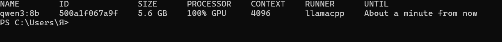
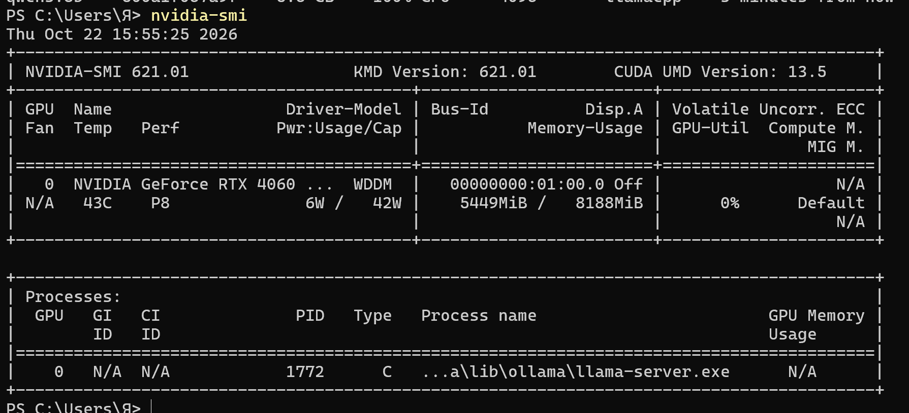
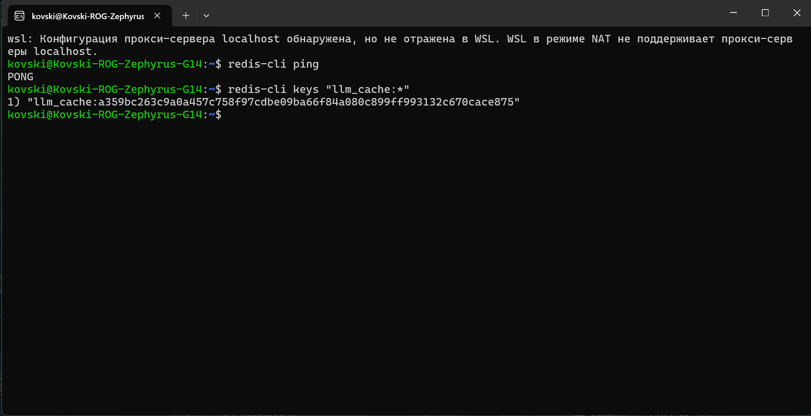
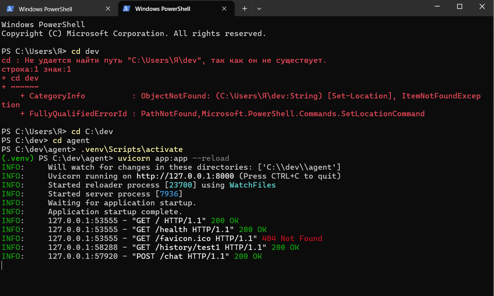
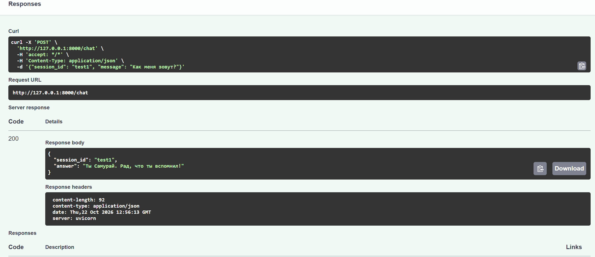
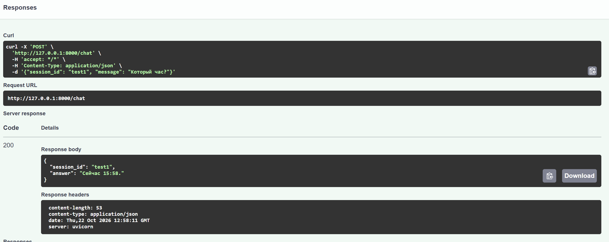
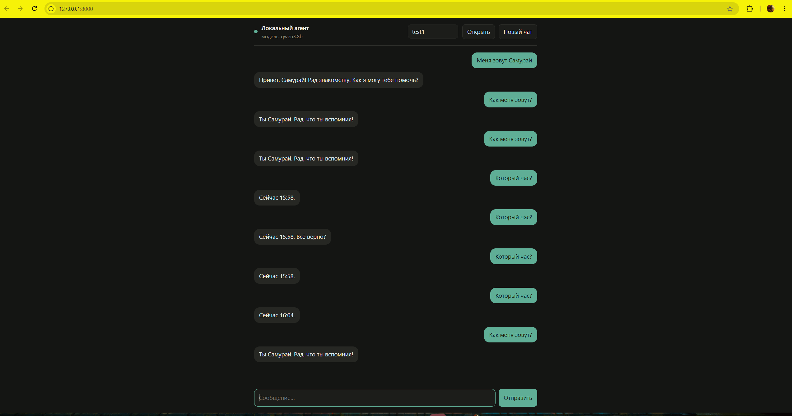

# Кейс #7: локальный LLM-агент (LangGraph + Ollama)


## Цель

Дать команде ML-инженеров возможность не зависеть от внешних веб-сервисов: поднять локальную LLM и чат-агента поверх неё, у которого история диалогов хранится во внешнем хранилище и переживает перезапуски.

## Отличие от исходного кейса

В кейсе агент собирается в n8n. Мы заменили n8n на код на Python, остальной стек сохранили.

| Компонент кейса | Как сделано у нас | Роль |
|---|---|---|
| n8n | LangChain + LangGraph, HTTP API на FastAPI | Логика агента, вызов инструментов |
| Ollama + модель | Ollama, модель `qwen3:8b` | Локальная LLM на GPU |
| PostgreSQL | PostgreSQL 16, чекпоинтер LangGraph (`langgraph-checkpoint-postgres`) | Хранение сессий и полного состояния агента |
| Redis | Redis в WSL (Ubuntu), свой кеш ответов LLM | Кеш ответов модели |
| Цепочка Chat Message → AI Agent → Chat Model | веб-чат → `POST /chat` → агент LangGraph → `ChatOllama` | Обработка сообщения |

Почему так: LangGraph даёт тот же агентный цикл (модель решает, вызвать ли инструмент, получает результат и отвечает), но описывается кодом, который хранится в git и запускается одной командой. Роль Redis изменилась: в кейсе он нужен n8n для очередей задач, у нас очередей нет, поэтому Redis используется как кеш ответов модели.

## Архитектура

```
Браузер (веб-чат, /)
        │  POST /chat {session_id, message}
        ▼
FastAPI (app.py) ── агент LangGraph ── инструмент current_time
        │                │
        │                ├── ChatOllama ──► Ollama :11434 (qwen3:8b, RTX 4060)
        │                │
        │                └── кеш ответов LLM ──► Redis :6379 (WSL)
        │
        └── чекпоинтер (история по thread_id) ──► PostgreSQL :5432, база agent
```

- `session_id` из запроса передаётся в LangGraph как `thread_id`. По нему чекпоинтер находит в Postgres историю диалога, поэтому разные сессии не смешиваются.
- Кеш ответов: ключ это SHA-256 от промпта (вместе с историей) и настроек модели, значение хранится в Redis сутки. Повторный одинаковый запрос не идёт в модель.
- Инструмент `current_time` возвращает время сервера. Он нужен, чтобы показать, что это агент, а не просто чат: модель сама решает, когда его вызвать.

## Окружение

| | |
|---|---|
| ОС | Windows 11 |
| GPU | NVIDIA GeForce RTX 4060 Laptop, 8 ГБ |
| ОЗУ | 16 ГБ |
| Python | 3.14 |
| Ollama | нативно под Windows, модель `qwen3:8b` (~5,6 ГБ в видеопамяти) |
| PostgreSQL | 16, служба Windows |
| Redis | 8.0, Ubuntu в WSL2 |

Выбор модели: `qwen3:8b` в квантизации Q4 целиком помещается в 8 ГБ видеопамяти, поддерживает вызов инструментов и нормально отвечает по-русски.

## Установка

### Ollama

```powershell
irm https://ollama.com/install.ps1 | iex
ollama pull qwen3:8b
```

### PostgreSQL

PostgreSQL установлен с официального сайта. База и пользователь для агента:

```sql
CREATE USER agent WITH PASSWORD 'agent_pass';
CREATE DATABASE agent OWNER agent;
```

### Redis

Официальной сборки Redis под Windows нет, поэтому он поднят в WSL:

```powershell
wsl --install -d Ubuntu --web-download
```

```bash
sudo apt update
sudo apt install -y redis-server
sudo service redis-server start
redis-cli ping
```

Из Windows Redis доступен на `localhost:6379`.

### Агент

```powershell
cd C:\dev\agent
python -m venv .venv
.venv\Scripts\activate
pip install -r requirements.txt
uvicorn app:app --reload
```

Интерфейс открывается на http://127.0.0.1:8000, документация API на http://127.0.0.1:8000/docs.

## API

| Метод | Путь | Назначение |
|---|---|---|
| GET | `/` | Веб-интерфейс чата |
| POST | `/chat` | Отправить сообщение агенту: `{"session_id": "...", "message": "..."}` |
| GET | `/history/{session_id}` | История диалога из Postgres |
| GET | `/health` | Статус сервиса и имя модели |

## Проверка работы

### 1. Модель работает локально на GPU

`ollama ps` показывает `100% GPU`, `nvidia-smi` показывает процесс `llama-server.exe` (тип C, вычисления CUDA) и ~5,4 ГБ занятой видеопамяти.




### 2. Redis доступен и хранит кеш

`redis-cli ping` отвечает `PONG`, ответы модели лежат под ключами `llm_cache:<sha256>`.



### 3. Агент запускается и подключается к Postgres и Redis

Без доступа к любой из баз приложение падает на старте, поэтому строка `Application startup complete` значит, что оба подключения успешны.



### 4. Агент помнит контекст

В сессии `test1` агенту сообщили имя, затем спросили его. Агент ответил правильно, то есть взял имя из истории диалога.



### 5. Агент вызывает инструмент

На вопрос «Который час?» агент вызывает `current_time` и называет время сервера.



### 6. История переживает перезапуск

Сервис, Ollama и WSL были полностью остановлены, компьютер выключен. На следующий день после запуска веб-чат подтянул всю переписку сессии `test1` через `/history`, а на вопрос «Как меня зовут?» агент снова ответил правильно. Значит, история хранится в Postgres, а не в памяти процесса.



## Ограничения

- Модель на 8 млрд параметров иногда ошибается: например, один раз на вопрос о времени повторила предыдущий ответ вместо вызова инструмента. При повторном запросе инструмент был вызван правильно. Для длинных цепочек с большим числом инструментов нужна модель крупнее.
- Redis в WSL не запускается сам вместе с Windows: перед работой нужно открыть Ubuntu и проверить `redis-cli ping`.
- Кеш срабатывает только на полностью совпадающий запрос вместе с историей, поэтому в живом диалоге попаданий немного. Основная его польза в повторяющихся запросах к модели.

## Итог

Локальный чат-агент поднят: LLM работает через Ollama на собственной видеокарте без внешних сервисов, агент на LangGraph умеет вызывать инструменты, история диалогов хранится в PostgreSQL и переживает перезапуск, ответы модели кешируются в Redis. Есть веб-интерфейс чата и HTTP API.
